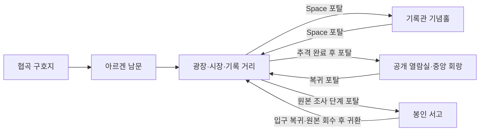

# 챕터 3 도시 구조와 기록관 포탈

2026-10-20 · 작업 브랜치 `codex/chapter3-city-architecture`

## 문서 분석과 사용자 확정 범위

[최종 스토리](../../_story_scene_production/05_final_chapters/CHAPTER_03_FINAL.md)의 S01~S10과 [감독 결정](../../_story_scene_production/04_director_decisions/CHAPTER_03_DECISION.md)을 순서대로 검토했다. S01은 기록관 기념홀, S02는 민원·배급 광장, S03은 시장·행정 수로의 추격, S04는 대서고·기념묘·폐쇄 수도원의 독립 증거, S05는 대서고 중앙 회랑, S06은 추방민 작업장, S07~S08은 봉인 서고와 반출 저지, S09~S10은 시민 회랑·정치 조치가 필요하다. 자산 장부의 C02~C03 부분에는 완성 도시 키트가 등록되어 있지 않다.

기존 구현은 기념홀·도시·봉인 서고 3개 지역과 조사 지점 위주였다. 도시 전체가 같은 바닥이고 개별 건물 충돌이 없었으며, 실내도 세계 도로로 이어져 있었다. 이번 사용자 확정은 **도시·거리를 분명히 구분하고, 건물을 개별 제작·배치·충돌 처리하며, 기록관만 포탈로 출입**하는 것이다. Blender 배경은 사용 가능한 선택지이며 필수 제작 도구로 요청된 것은 아니다.

이번에는 기존 Renderer의 도형으로 각각의 건물·성벽·서가를 그린다. 배경 한 장으로 합치지 않으며 새 스프라이트를 생성하지 않는다. 따라서 Blender 생성물이나 완성 픽셀 스프라이트를 제공했다고 주장하지 않는다. 좌표·크기·바닥 색·외관은 구현 선택이고 실제 화면에서 조정할 수 있다.

## 1. 야외 도시와 거리

성벽으로 도시 경계를 만들고 남문에 400 단위의 통행 공간을 남겼다. 협곡 구호지의 외부 도로는 도시 남문으로 이어진다. 남문·시장·기념묘·수도원 앞에 별도 표지판을 두고, HUD 지역 이름과 바닥 포장을 구획마다 바꾼다.

| 구획 | 역할과 배치 |
| --- | --- |
| 남문·행정 광장 | 민원·배급·허가 창구. 기록관 기념홀 별관은 광장 서편에 놓는다. |
| 시장 거리·행정 수로 | 추격용 사각 골목과 지름길. 기존 연락책 경로를 건물이 가로막지 않는다. 동쪽 수로는 별도 지형이다. |
| 서쪽 기록 거리 | 왕립 대서고 외관과 공개 열람실 포탈. 서편 우회 도로가 건물 몸체를 돌아간다. |
| 동쪽 기념묘·석공 마당 | 세 기초와 외부 공방 장부. 공방은 닫힌 건물이다. |
| 폐쇄 수도원 외벽 조사로 | 닫힌 수도원 외관과 입소실 배치·장례 명부·후기 설교 기록을 순서대로 조사한다. |
| 추방민 공방 거리 | 에드릭과 인장 대조. 외부 접견으로 처리하며 공방 내부에 들어가지 않는다. |
| 시민 회랑·왕실 연락소 | 공증 사본·증언·정치 조치·보급·조사 승인. 연락소는 외부 창구다. |
| 기록관 봉인동 앞마당 | 옛 군용 통로에 해당하는 봉인 서고 포탈. 스토리 선행 조건을 유지한다. |

수도원은 최신 사용자 요청에 맞춰 내부 출입을 없앴다. 기존 세 조사 지점의 위치·순서·필체와 인장 단서는 유지하고, 외벽의 방 배치와 이관 기록을 따라가는 표현으로 바꿨다. 이는 최종 스토리의 건물 내부 동선을 외부에서 읽는 방식으로 조정한 구현 차이다. 별도 수도원·공방·민가 실내나 출입 포탈은 없다.

## 2. 개별 건물과 충돌

[MapLayout.h](../../SimpleGame/src/world/MapLayout.h)의 `MapBuilding`은 고유 ID·이름·직사각형 바닥 점유 영역·높이·외관 종류를 가진다. [Chapter3Architecture.cpp](../../SimpleGame/src/chapters/Chapter3Architecture.cpp)가 기록관 3개 외관, 닫힌 수도원·주택·공방·연락소, 성벽을 별도 객체로 배치한다. 긴 벽은 최대 320 단위의 조각으로 나눠 청크 스트리밍에서 끝부분이 빠지지 않게 한다.

`LevelMap::Blocked`는 각 건물의 바닥 영역에 플레이어 반지름 11을 더해 검사한다. A*와 투사체 가시선도 기존 `Blocked/ClearPath`를 통해 같은 충돌을 사용한다. `WorldAtlas::Build`는 건물 좌표를 세계 좌표로 변환한다. 외관 렌더와 충돌이 같은 점유 데이터를 사용하므로 이미지만 덮고 충돌을 별도로 추측하지 않는다.

[BuildingView.cpp](../../SimpleGame/src/ui/BuildingView.cpp)는 개별 지붕·벽면·창·기둥·닫힌 문·이름판·그림자를 그린다. 청크 객체 종류 13으로 등록하고 건물 앞쪽 발선으로 캐릭터와 깊이를 정렬한다. 건물 크기를 반영해 화면 컬링 범위를 확장한다. 도시와 실내의 장식은 직접 배치하고, 해당 구획에서 무작위 나무·바위를 생성하지 않는다.

## 3. 기록관 포탈과 실내

| 포탈 | 실내와 선행 조건 | 복귀 |
| --- | --- | --- |
| 기록관 기념홀 별관 | S01의 일곱 불·명판·탁본. 공개 포탈. | 행정 광장 서편 |
| 왕립 대서고 공개 열람실 | 추격 완료 후 Research 단계부터 입장. 초판·개정본·후대 사본과 세라드 통보를 실내로 옮긴다. | 서쪽 기록 거리 |
| 기록관 봉인동·옛 군용 통로 | 기존 Infiltration 단계부터 입장. 비살상 잠입·세라드전·반출 저지 유지. | 입구 포탈로 앞마당 복귀 또는 원본 회수 후 시민 회랑 귀환 |

`ReadingRoom = 10`을 추가해 챕터 3은 4개 지역, 전체 세계는 10개 지역이 된다. 기념홀·공개 열람실·봉인 서고는 `portalInterior`로 표시하고, 자동 지역 연결 도로를 만들지 않는다. 별도 좌표에 실내를 놓고 사방을 충돌 벽으로 닫는다. 일반 플레이에서 실내로 들어가는 통로는 등록된 포탈뿐이다. 챕터 스킵과 개발용 직접 시작은 기존처럼 목적지로 이동할 수 있다.

포탈은 Space 상호작용으로 작동한다. `Chapter3::Interact`가 단계 잠금을 확인해 이동 요청을 만들고, [GameSessionPortals.cpp](../../SimpleGame/src/app/GameSessionPortals.cpp)가 등록된 출발 포탈·목적지·도착 지점 충돌을 검증한 뒤 지역을 활성화한다. 기존 오픈월드 지도는 유지하며 화면 전체를 다른 맵으로 다시 로드하지 않는다. `PrototypeWorld`의 기존 이동 후 처리로 카메라·공격·투사체를 정리한다. 조사·선택·적 상태·금화·레벨은 포탈 이동으로 초기화하거나 보상하지 않는다. 기존 야영지 체크포인트 정책은 유지한다.

목표가 다른 실내에 있으면 실제 방 좌표 대신 이용할 외부 포탈을 먼저 안내한다. 현재 실내에서 도시 또는 다른 실내로 가야 할 때는 복귀 포탈을 먼저 표시한다. 세계 지도 목록은 실내를 `[포탈 실내]`로 구분한다. 미리보기, 챕터 2 전체 스킵 후 기념홀 진입, 챕터 3 전체 스킵 후 아르겐 귀환을 유지한다.

## 4. 정적 검토와 실행 확인 항목

- 소스의 도시 배치 14개(긴 성벽 분할 전)와 조사·포탈·남문 지점 32개의 충돌 비중첩을 확인했다. 건물·수로를 고려한 25 단위 검토 격자에서 32개 지점이 남문 입구와 연결된다. 실제 플레이어나 A*를 실행한 검사가 아니다.
- 서식, 프로젝트·필터의 신규 파일 단일 등록, 로컬 include, 문서 상대 링크, 포탈 목적지 검증 순서와 실내 도로 차단을 정적으로 확인한다.
- [Chapter3Verification.cpp](../../SimpleGame/src/verification/Chapter3Verification.cpp)에 포탈 잠금·왕복·조사 상태 보존·건물 충돌·도착 지점·목표의 포탈 유도를 확인하는 회귀 소스를 추가했다. 기존 스토리 검사의 기록 열람·통보 위치와 세계 지역 수를 갱신했다.
- 게임 빌드·실행·C++ 회귀 검사·화면 캡처·성능 측정은 수행하지 않았다. 외관 가림·이름표 겹침·실제 길 찾기와 조작감은 사용자 실행 후 확인해야 한다.
